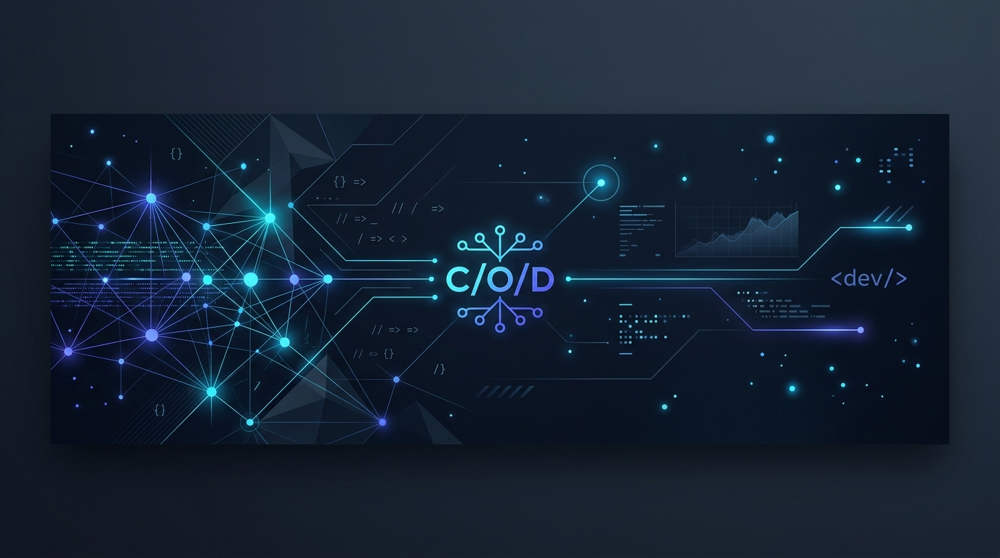
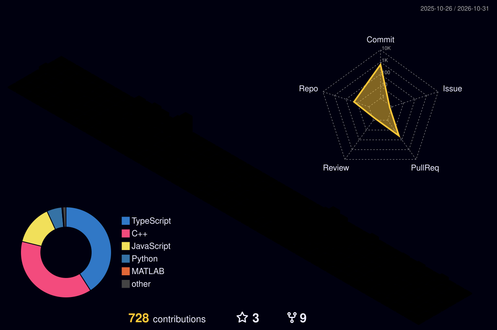

  

<strong>Backend &amp; Full-Stack Engineer · NIT Raipur ’27</strong> 
<em>Part-Time Developer @ Cubelelo &nbsp;·&nbsp; Part-Time Developer @ FOSSEE, IIT Bombay</em>

  

**From real-world telemetry to distributed services — I build systems that survive messy production data.**

I specialize in **resilient backend systems, high-throughput API integrations, intelligent developer tooling, and reinforcement learning for wireless networks.**

## ✦ About me

- 🎓 **B.Tech ECE**, National Institute of Technology Raipur · **2023–2027**
- 🛒 Developer at **Cubelelo** — reconciling order and inventory state across **12+ marketplace APIs** with diverse schemas and rate limits
- 🏛️ Developer at **FOSSEE, IIT Bombay** — engineering grammar-based parsers and RAG pipelines for **OpenFOAM / CFD** configuration files
- 📡 Wireless & AI Researcher — **First Author** on an IEEE paper (under review) on **Multi-Actor DRL for RIS-IAB Networks**
- 🏆 **Winner**, Hack-o-Harbour 2025 (150+ teams) & **Runner-up**, CodeUtsav 8.0 (300+ teams, flagship hackathon at NIT Raipur)
- 🏗️ Deep focus on **backend architectures, distributed systems, resilient retries, idempotent state handling, and automated PR review engines**
- 💼 Open to **Software Engineering / Backend / Systems / Applied AI** opportunities

## 🧰 Tech stack

### Languages

### Backend & Full-Stack

### Data, Cloud & DevOps

### AI / ML & Scientific Computing

### Testing & Developer Tools

## 🛠️ Featured projects

<table>
<tr>
<td width="50%" valign="top">

### ⚙️ [FlowOps](https://github.com/vedantDube/FlowOps)
**Engineering intelligence SaaS & automated PR review engine**

`Next.js` `Express` `PostgreSQL` `Prisma` `Docker` `GitHub OAuth` `Socket.IO`

- Multi-tenant platform ingesting GitHub commits, PRs, and reviews via OAuth + webhooks
- AI review pipeline for automated security audits & anti-pattern detection
- PR automation engine auto-approving low-risk changes & nudging stale reviews
- 4-tier RBAC system with live dashboard analytics and telemetry via Socket.IO

[**Source →**](https://github.com/vedantDube/FlowOps) · [**Live Demo →**](https://flow-ops-liard.vercel.app/)

</td>
<td width="50%" valign="top">

### 🍳 [CookGPT](https://github.com/vedantDube/Cook_GPT)
**Multimodal RAG chatbot with sub-second retrieval (1st Place Winner)**

`Flask` `LangChain` `Pinecone` `React` `Gemini` `Clerk`

- Multimodal retrieval-augmented generation supporting text, images, PDFs, CSVs & audio
- Sub-second semantic search over **10,000+ vector embeddings** via Pinecone
- Multimodal reasoning powered by Google Gemini with conversational context memory
- Production-grade authentication, rate-limiting & session persistence via Clerk

[**Source →**](https://github.com/vedantDube/Cook_GPT) · [**Live Demo →**](https://cook-gpt-azure.vercel.app/)

</td>
</tr>
<tr>
<td width="50%" valign="top">

### 🔬 [OpenFOAM × LLM Integration](https://github.com/FOSSEE/pyvnt_llm/tree/vedant_main)
**CFD parser & RAG tooling @ FOSSEE, IIT Bombay**

`Python` `OpenFOAM` `PyVNT` `HuggingFace` `LangChain`

- Grammar-based parser converting 100+ non-standard CFD case configs into structured ASTs
- LLM-assisted RAG pipeline mapping free-form CFD comments directly into simulation fields
- **35% accuracy improvement** over legacy regex-based extraction pipelines
- Integrated into FOSSEE Python-OpenFOAM toolchain for automated scientific workflows

[**Source Branch →**](https://github.com/FOSSEE/pyvnt_llm/tree/vedant_main)

</td>
<td width="50%" valign="top">

### 📡 [Multi-Actor DRL for RIS-IAB Networks](https://github.com/vedantDube/Hybrid_RIS)
**Deep reinforcement learning for wireless optimization (IEEE Submitted)**

`Python` `MATLAB` `Deep RL` `DDPG` `DistilBERT` `PyTorch`

- First-author research optimizing hybrid Reconfigurable Intelligent Surfaces (RIS)
- Novel multi-actor Deep Deterministic Policy Gradient (DDPG) + DistilBERT architecture
- Boosted network energy efficiency by **17.4% to 42.1%** in dense interference environments
- Submitted and under peer review for IEEE publication

[**Source →**](https://github.com/vedantDube/Hybrid_RIS)

</td>
</tr>
</table>

## 💼 Experience & research

**🛒 Part-Time Developer — Cubelelo** · *2025–Present*

- Reconciling order and inventory state across **12+ marketplace APIs** with distinct rate limits, error schemas, and webhooks.
- Designing idempotent state transitions and retry pipelines that prevent inventory discrepancies across production orders.

**🏛️ Part-Time Developer — FOSSEE, IIT Bombay** · *2025–Present*

- Built grammar-based AST parsers and RAG pipelines for OpenFOAM computational fluid dynamics case files.
- Automated simulation parameter validation and extraction, improving configuration parsing accuracy by **35%**.

**📄 Wireless & Deep RL Research Author** · *2025–Present*

- First author on an IEEE paper (under review) formulating joint beamforming and phase shift optimization in RIS-assisted networks using Multi-Actor Deep RL.

## 📊 Contribution highlights

### 🌌 3D Contribution Calendar

<!-- Generated by .github/workflows/contribution-art.yml -->

### 🐍 Watch the contribution trail

<!-- Generated by .github/workflows/contribution-art.yml -->

Contribution visuals are generated automatically from public GitHub activity. The 3D graphic commits to the default branch; the snake is published to the <code>output</code> branch.

 

### 📈 GitHub activity & analytics

  
  &nbsp;
  

## 🏆 Milestones & highlights

| Milestone | Details |
| --- | --- |
| 🥇 **Hack-o-Harbour 2025** | **Winner** among 150+ teams (CookGPT) |
| 🥈 **CodeUtsav 8.0** | **Runner-up** (300+ teams, flagship hackathon at NIT Raipur) |
| 📄 **IEEE Research Paper** | **First Author** — Multi-Actor DRL for Hybrid RIS (under peer review) |
| 🧩 **LeetCode** | Active Problem Solver ([@vedhem999](https://leetcode.com/u/vedhem999)) |
| ⚔️ **CodeChef** | Competitive Programmer ([@odinforce314](https://codechef.com/users/odinforce314)) |
| 🎓 **NIT Raipur (ECE ’27)** | Pre-final Year B.Tech Scholar |

---

### Build. Observe. Improve. Repeat.

**Interested in backend architectures, distributed services, or applied AI systems?**

[**Connect on LinkedIn**](https://linkedin.com/in/vedant-dubey-55a934287) · [**Drop me an Email**](mailto:vedhem999@gmail.com) · [**Check my Code**](https://github.com/vedantDube)

